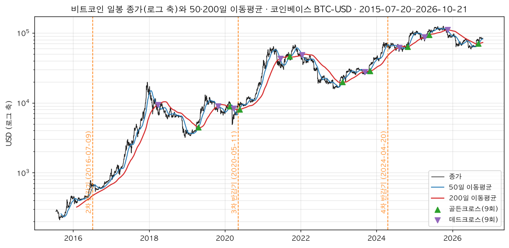
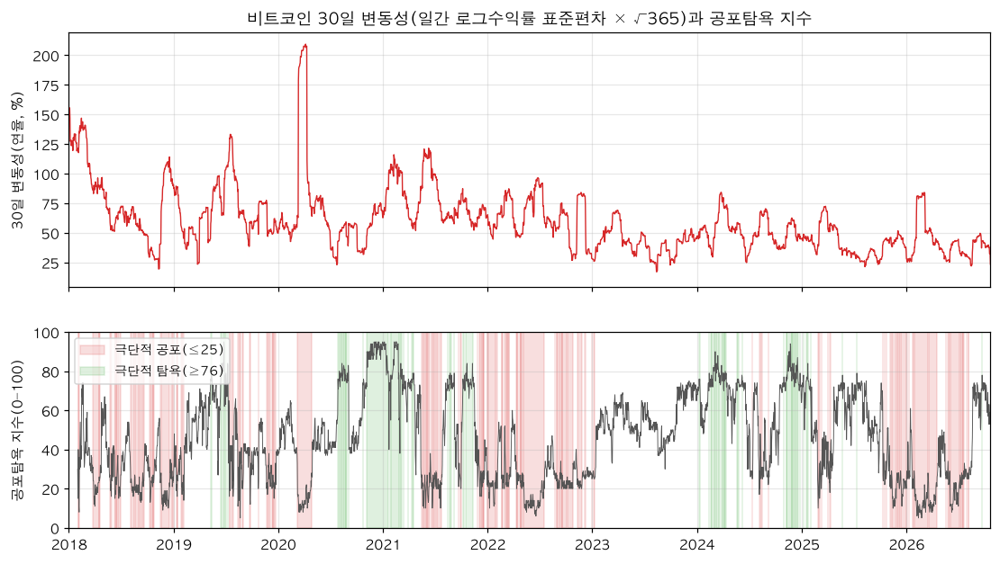
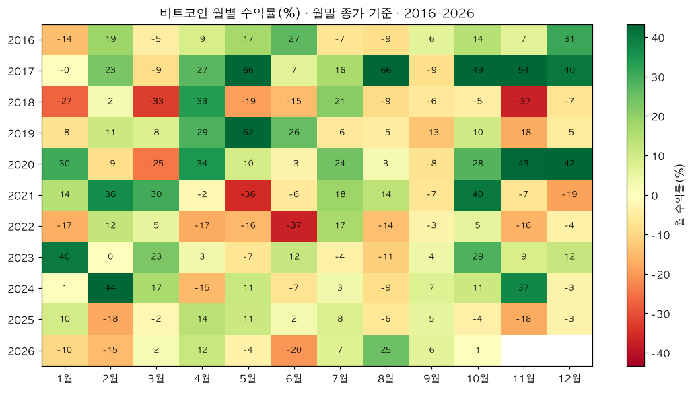
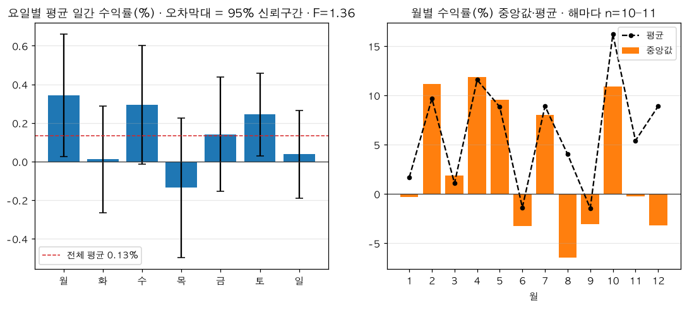
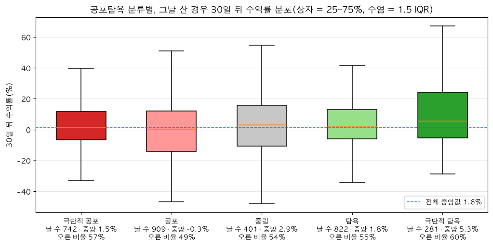
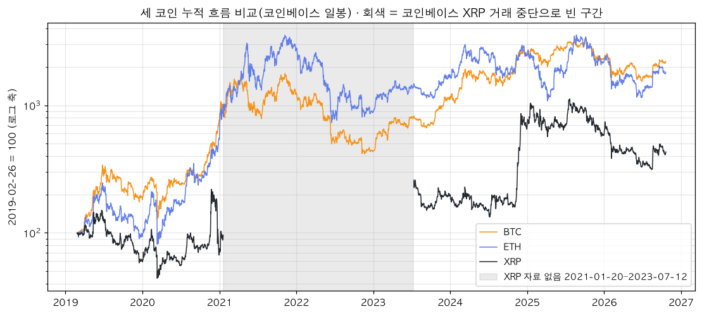
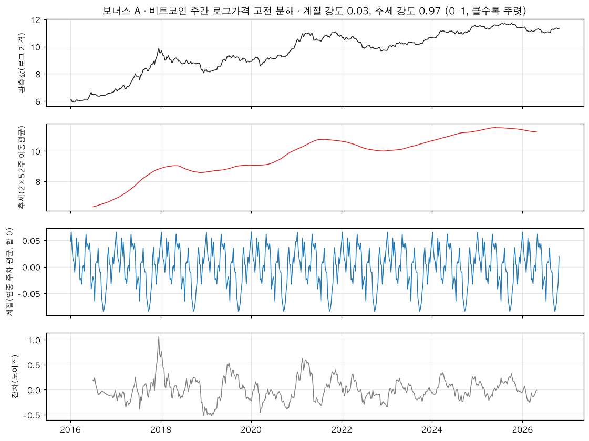
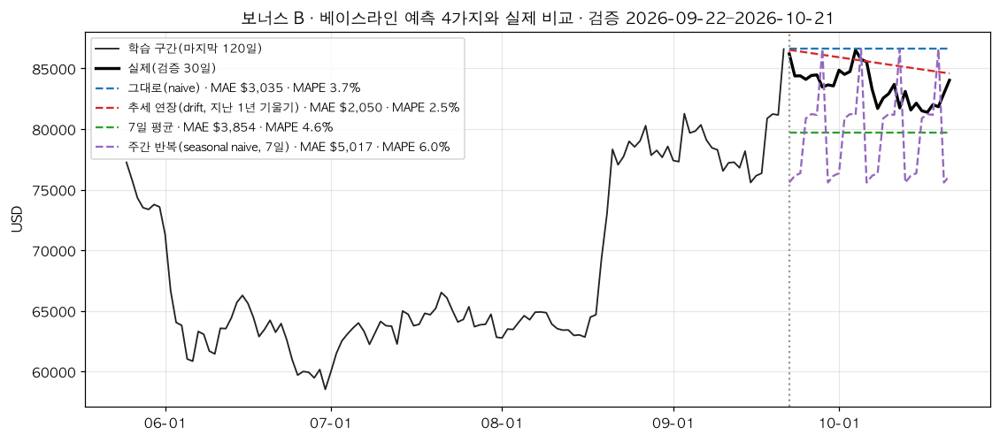

# 비트코인 11년: 추세는 뚜렷하고, 계절은 흐릿하다

**시계열 트렌드 분석 리포트** · 코디세이 미션 'AI 데이터 분석: 데이터 기반 트렌드 분석' · 작성 김호연(개발자 miru) · 자료 기준 2026-10-21(UTC)

> 이 리포트는 공부·분석 기록이며 투자 권유가 아닙니다. 숫자는 모두 `python analysis.py`가 만든 `outputs/summary.json`에서 왔습니다.

## 0. 한눈에

1. 비트코인 가격의 움직임은 **추세가 대부분**이고(분해 추세 강도 0.97), **달력 계절성은 약하다**(계절 강도 0.03, 요일 차이 F=1.36으로 우연 수준).
2. **200일 이동평균 위에 있던 날**은 30일 뒤 수익률 중앙값이 **+4.25%**로, 아래에 있던 날(+1.55%)보다 높았다.
3. **반감기 뒤 525·546·534일**에 주기의 꼭지가 왔지만, 상승폭(+2,888% → +688% → +92%)과 꼭지 뒤 하락폭(−84% → −77% → −53%)은 주기마다 **작아졌다**.
4. 공포탐욕 지수가 **'극단적 탐욕'인 날 뒤 30일**이 오히려 가장 좋았다(중앙값 +5.34%). '공포에 사라'는 통념은 이 자료에서 확인되지 않았다.
5. 예측은 **'그대로(어제 값)'가 가장 어려운 기준선**이다. 24개 구간 평균 오차(MAPE)에서 그대로 6.63%가 1등이었다.

## 1. 분석 주제와 고른 이유

- **주제:** 비트코인 일봉 가격(2015-07-20–2026-10-21)의 추세·변동성·계절성, 그리고 시장 심리(공포탐욕 지수)와의 관계.
- **고른 이유:** 작성자는 팀 프로젝트 [Top 3 Crypto](https://top3-crypto.vercel.app)(4시간봉 신호 보드)에 참여했고, 그 뒤를 잇는 개인 프로젝트 **알프레도(Alfredo, 투자 집사 에이전트)** 의 '코인' 탭을 만들고 있다. 짧은 신호 전에 **긴 흐름(추세·국면·변동성)** 을 데이터로 이해해야 알프레도가 사용자에게 "지금이 어떤 국면인지"를 근거와 함께 설명할 수 있다. 이 분석은 그 설명의 바탕이 된다.

## 2. 분석 질문

| # | 질문 | 성격 |
|---|---|---|
| Q1 | 2015–2026년 비트코인에는 어떤 추세가 있었고, 50·200일 이동평균으로 본 상승·하락 국면은 언제 바뀌었나? 반감기와 주기의 꼭지는 어떤 관계였나? | 그래프로 확인 + 해석 |
| Q2 | 변동성은 시간이 지나며 줄었나? 변동성이 큰 시기에 시장 심리(공포탐욕)는 어땠나? | 그래프로 확인 |
| Q3 | 특정 요일·월에 수익률이 다른가(계절성)? 그 차이는 우연 수준을 넘나? | 집계 + 검정 |
| Q4 | 공포탐욕 지수가 극단일 때 산 경우, 30일 뒤 수익률은 평소와 달랐나? | 추가 해석 필요 |

## 3. 데이터 설명

| 자료 | 출처(사이트·주소) | 기간(UTC) | 행 수 | 열 |
|---|---|---|---|---|
| 비트코인 일봉 BTC-USD | Coinbase Exchange 공개 시세 API, https://api.exchange.coinbase.com/products/BTC-USD/candles | 2015-07-20 – 2026-10-21 | **4,112** | date, open, high, low, close, volume |
| 이더리움 일봉 ETH-USD(비교용) | 같은 API | 2016-05-18 – 2026-10-21 | 3,807 | 같음 |
| 리플 일봉 XRP-USD(비교·결측 사례) | 같은 API | 2019-02-26 – 2026-10-21 | 1,891 | 같음 |
| 공포탐욕 지수(Crypto Fear & Greed Index) | alternative.me, https://api.alternative.me/fng/ (지수 설명 https://alternative.me/crypto/fear-and-greed-index) | 2018-02-01 – 2026-10-21 | 3,181 | date, value(0–100), classification |

- **수집:** `data/collect.py`(표준 라이브러리만 사용)가 위 공개 API에서 받아 `data/raw/*.csv`로 저장한다. 하루 단위는 UTC 자정 기준이다.
- **수집 검증:** 같은 기간을 따로 모아 둔 사본(작성자의 Top 3 Crypto 수집 DB, 같은 출처)과 대조했다. BTC 4,112일·ETH 3,807일·XRP 1,891일 종가와 공포탐욕 3,181일 값이 **모두 일치**했다(2026-10-22 확인).
- **공포탐욕 분류(자료 값으로 확인):** 극단적 공포 5–25, 공포 26–46, 중립 47–54, 탐욕 55–75, 극단적 탐욕 76–95.

## 4. 데이터 정제: 결측치와 이상치

| 자료 | 빈 칸 | 중복 날짜 | 빠진 날 | 값 오류(고가<저가 등) |
|---|---|---|---|---|
| BTC | 0 | 0 | 0 | 0 |
| ETH | 0 | 0 | 2일(2016-05-21–22) | 0 |
| XRP | 0 | 0 | **904일(2021-01-20 – 2023-07-12)** | 0 |
| 공포탐욕 | 0 | 0 | 4일(2018-04-14–16, 2024-10-26) | – |

**결측 처리 기준**
- 날짜를 하루 간격으로 다시 줄 세워(재색인) 빠진 날을 찾았다.
- **3일 이하의 빈 날**(거래소 점검·자료 누락으로 봄)은 직전 값으로 채웠다(ETH 2일, 공포탐욕 4일).
- **더 긴 공백은 채우지 않았다.** XRP의 904일 공백은 코인베이스가 미국 증권거래위원회(SEC)의 리플 소송 뒤 2021-01-19에 XRP 거래를 멈추고 2023-07-13에 다시 연 기간과 맞는다(코인베이스 공지 https://www.coinbase.com/blog/coinbase-will-suspend-trading-in-xrp-on-january-19). 값을 지어 넣으면 없는 가격을 만드는 셈이라 비워 두고, 비교 그림(그림 8)에 회색으로 표시했다.

**이상치 기준**
- 일간 로그수익률의 z 점수(전체 기간 평균·표준편차 기준)가 **|z| > 4**인 날을 이상치로 **표시만** 했다. BTC에서 **22일**이었다.
- 가장 큰 날은 **2020-03-12 −38.8%(z = −14.1)**, 코로나19 충격 날이다. 그다음은 2017-07-20 +27.2%(z = 6.8)이다(목록 `outputs/btc_outliers.csv`).
- **지우지 않은 이유:** 값 오류(고가<저가, 0 이하 가격)는 0건이었다. 이상치는 실제로 일어난 급락·급등이고, 변동성과 하락폭을 재는 데 꼭 필요한 정보이기 때문이다.

## 5. 분석 결과와 시각화

쓴 시계열 기법은 다음과 같다.
- **이동평균:** 50·200일 평균으로 추세와 국면을 본다.
- **변화율:** 일간 로그수익률, 월 수익률, 30일 뒤 수익률을 쓴다.
- **변동성:** 30일 이동 표준편차를 1년 기준으로 바꿔 쓴다.
- **구간별 통계:** 반감기 주기, 200일선 위·아래, 공포탐욕 분류별로 나눠 본다.
- **월·요일 집계:** 달력 효과를 본다.
- **보너스:** 고전 분해와 베이스라인 예측(7절).

### 그림 1. 가격과 50·200일 이동평균, 반감기


- **관찰(사실):** 2018-03 이후 골든크로스(50일선이 200일선 위로)와 데드크로스(반대)가 각각 9번 있었다. 마지막은 2026-09-08 골든크로스이다. 2026-10-21 종가 $84,024.67은 50일선 $81,699와 200일선 $72,732 위에 있다. 200일선을 계산할 수 있는 날 가운데 **61.7%** 가 200일선 위였다.
- **30일 뒤 수익률(200일선 위 vs 아래):**

  | 국면 | 날 수 | 평균 | 중앙값 | 오른 비율 |
  |---|---|---|---|---|
  | 200일선 위 | 2,383 | +9.08% | **+4.25%** | 59.0% |
  | 200일선 아래 | 1,500 | +2.39% | **+1.55%** | 55.3% |

- **반감기 주기**(반감기 뒤 2년 안 최고 종가를 그 주기의 꼭지로 정의):

  | 반감기 | 그날 가격 | 1년 뒤 | 꼭지 날짜(며칠 뒤) | 꼭지까지 | 꼭지 뒤 최저(날짜) |
  |---|---|---|---|---|---|
  | 2016-07-09 | $657.61 | +281.5% | 2017-12-16 (525일) | +2,888.1% | −83.8% (2018-12-15) |
  | 2020-05-11 | $8,572.40 | +562.0% | 2021-11-08 (546일) | +688.1% | −76.7% (2022-11-21) |
  | 2024-04-20 | $64,968.87 | +31.1% | 2025-10-06 (534일) | +92.0% | −53.1% (2026-06-30, 진행 중) |

- **해석(가설):** 200일선 위에서 성과가 더 좋았던 것은 **추세가 이어지는 성질(모멘텀)** 로 설명할 수 있다. 다만 날 수에는 30일 창이 겹쳐 독립 표본이 훨씬 적다. 강세장이 길었던 시기의 비중도 크다. 반감기 뒤 꼭지 시점이 비슷한 것은 주기가 3번뿐이라 우연일 수 있다. 상승폭이 줄어드는 것은 시장 규모가 커진 결과라는 가설과 맞는다.
- 연도별 수익률(연말 종가 기준): 2017 +1,324%, 2018 −73%, 2020 +305%, 2022 −64%, 2024 +121%, 2025 −6.3%, 2026년(10-21까지) −4.0%.

### 그림 2. 30일 변동성과 공포탐욕 지수


- **관찰:** 연평균 30일 변동성(연율)은 다음과 같이 움직였다.
  - 2017년 84.3%, 2018년 79.9%, 2021년 78.9%
  - 2023년 41.7%, 2025년 41.1%, 2026년 42.2%
  - 최고값은 2020-04-06의 **209.4%**(코로나 급락 직후), 2026-10-21 값은 **23.5%** 다.
- **공포탐욕과의 상관(겹치는 3,185일):**
  - 변동성과 공포탐욕 값: **−0.17**(공포일수록 변동성이 조금 큼)
  - 변동성과 '50에서 떨어진 정도(극단성)': **+0.31**
- **해석(가설):** 시장이 커지고 참여자가 다양해지며 변동성이 구조적으로 낮아졌을 수 있다. 심리가 어느 쪽이든 극단일 때 가격이 크게 움직인다. 상관은 원인을 말해 주지 않는다. 가격이 크게 움직여서 심리가 극단이 됐을 수도 있다.

### 그림 3. 월별 수익률 표(히트맵)


- **관찰:** 10월은 11번 중 9번(82%) 올랐다(평균 +16.2%, 중앙값 +10.9%). 4월(중앙값 +11.8%)·2월(+11.2%)도 좋았다. 중앙값이 음수인 달은 1·6·8·9·11·12월로, 가장 낮은 달은 8월(−6.5%)·6월(−3.3%)·12월(−3.2%)·9월(−3.1%)이다. 8월은 평균 +4.0%인데 중앙값은 −6.5%라, 2017년 +66% 한 해가 평균을 끌어올렸다. 2026년 10월 칸(+1%)은 21일까지라 다른 칸과 같은 기준이 아니다.
- **해석(가설):** 월마다 표본이 10–11개뿐이고 한 달 수익률의 흩어짐(수십 %)이 커서, 이 차이를 규칙으로 보기는 어렵다. 12개 달을 동시에 보면 우연히 좋아 보이는 달이 생기기 쉽다(다중 비교).

### 그림 4. 요일·월 효과


- **관찰:** 2016년 이후 하루 평균 수익률은 0.134%다. 요일별 평균은 −0.136%(목)에서 +0.343%(월) 사이다. 요일마다 95% 신뢰구간이 **모두 전체 평균을 포함**한다. 일원분산분석 F = 1.36(자유도 6, 3,940)은 5% 기준 임계값(약 2.10)보다 작다.
- **해석:** **요일 효과의 근거는 없다.** 하루 수익률의 표준편차(3.51%)가 요일 간 차이(0.5%p 안팎)보다 훨씬 커서, 그 차이는 노이즈 속에 묻힌다.

### 그림 5. 공포탐욕 분류별 30일 뒤 수익률


| 분류 | 날 수 | 구간 수* | 평균 | 중앙값 | 오른 비율 |
|---|---|---|---|---|---|
| 극단적 공포 | 742 | 128 | +2.98% | +1.50% | 57.1% |
| 공포 | 909 | 217 | +0.91% | −0.29% | 49.4% |
| 중립 | 401 | 158 | +3.32% | +2.91% | 53.9% |
| 탐욕 | 822 | 160 | +5.29% | +1.77% | 54.9% |
| **극단적 탐욕** | 281 | 64 | **+13.10%** | **+5.34%** | **60.1%** |
| 전체 | 3,155 | – | +3.93% | +1.55% | 54.2% |

\* 구간 수 = 같은 분류가 이어진 덩어리의 수. 30일 뒤 수익률 창이 겹치므로 실제 독립 표본은 '날 수'보다 '구간 수'에 가깝다.

- **해석(가설):** 극단적 탐욕은 강세장 한가운데 몰려 나타나고, 추세가 이어지며 수익이 더 났을 수 있다. 극단적 탐욕 구간이 64개뿐이라, 큰 상승장 몇 번(2020–2021)이 결과를 좌우했을 수 있다. 다음에 볼 것은 추세 국면(200일선)을 같이 나눈 조건부 비교다.

### 그림 8. 세 코인 비교와 결측 구간


- **관찰:** 2019-02-27 이후 일간 수익률 상관은 BTC–ETH 0.83, BTC–XRP 0.62, ETH–XRP 0.67이다. 연율 변동성은 BTC 66.8%, ETH 92.8%, XRP 86.2%다. 최대 낙폭은 BTC −83.8%(2017-12-16 → 2018-12-15), ETH −94.0%(2018-01-13 → 2018-12-14)다. XRP는 코인베이스 자료가 2019년부터라 2018년 하락이 빠져 있다.
- **해석:** 세 코인은 같은 방향으로 크게 움직인다. 그래서 여러 코인에 나눠 담아도 위험이 생각만큼 줄지 않는다(가설, 상관만 본 결과).

## 6. 인사이트

| # | 관찰(Fact, 수치) | 원인 가설(Why) | 행동(Action) |
|---|---|---|---|
| 1 | 분해에서 추세 강도 **0.97**, 계절 강도 **0.03**이다. 요일 F = 1.36으로 우연 수준이다. 월별 차이는 해마다 n=10–11로 불안정하다 | 가격은 공급 일정(반감기)·유동성·채택 같은 긴 요인으로 움직이고, 달력 효과는 하루 변동(3.51%)에 묻힌다 | 알프레도 코인 탭은 '몇 월·무슨 요일에 사라' 같은 달력 규칙을 만들지 않는다. **추세 국면과 변동성 국면**을 먼저 보여 준다 |
| 2 | 200일선 위였던 날의 30일 뒤 중앙값은 **+4.25%**(오른 비율 59.0%, 2,383일), 아래였던 날은 **+1.55%**(55.3%, 1,500일)다 | 추세가 이어지는 모멘텀. 반례: 2021-11 꼭지 직후처럼 200일선 위에서 하락이 시작된 때도 있다 | 대시보드에 '200일선 위/아래' 국면 배지를 **설명용**으로 단다. 매수 신호로 쓰지 않는다. 다음 분석에서 수수료와 겹치는 창을 고려해 다시 잰다 |
| 3 | 반감기 뒤 꼭지까지 **525·546·534일**로 비슷했다. 꼭지까지 상승은 +2,888% → +688% → +92%, 꼭지 뒤 하락은 −83.8% → −76.7% → −53.1%(진행 중)다 | 시장이 커질수록 같은 공급 충격의 효과가 줄었다(주기 3번뿐이라 가설) | '반감기 달력'으로 예측하지 않는다. 주기 크기가 줄어드는지 **관찰 지표**로 대시보드에 둔다 |
| 4 | 연평균 변동성은 84.3%(2017) → 41.1%(2025)로 내려왔다. 2026-10-21 변동성은 **23.5%**, 심리 극단성과 변동성 상관은 **+0.31**이다 | 시장 성숙(규모·참여자). 심리가 극단이면 가격이 크게 움직이거나, 큰 움직임이 심리를 극단으로 만든다(방향 미확인) | 변동성 국면(낮음·보통·높음)을 함께 보여 주고, 알프레도가 "지금 변동성은 지난 몇 년보다 낮은 편"처럼 **근거 숫자와 함께** 설명하게 한다 |
| 5 | '극단적 탐욕' 뒤 30일 중앙값은 **+5.34%**(60.1%)로 가장 높고, '극단적 공포'는 +1.50%(57.1%)다 | 탐욕은 강세장 속에 몰려 나타난다(모멘텀). 독립 구간이 64개로 적어 큰 상승장 몇 번에 좌우됐을 수 있다 | 공포탐욕을 **단독 역발상 신호로 쓰지 않는다.** 추세 국면을 함께 나눈 조건부 분석을 다음 과제로 남긴다 |
| 6 | 마지막 30일은 추세 연장(drift)이 1등이었다(MAPE 2.47%). 그러나 24개 구간 평균은 **그대로(naive) 6.63%가 1등**이다 | 가격이 '무작위 걷기'에 가까워 어제 값이 가장 좋은 추정이 되기 쉽다 | 화면에 예측 숫자를 내지 않는다. 새 모델은 **'그대로'를 여러 구간에서 이길 때만** 쓴다 |

## 7. 보너스: 시계열 분해와 베이스라인 예측

### A. 시계열 분해


- **방법:** 주간 마지막 종가의 자연로그(2016-01–2026-10)를 **고전 가법 분해**로 나눴다.
  - 추세 = 2×52주 중심 이동평균
  - 계절 = 연중 주차별 평균 편차(합 0)
  - 잔차 = 나머지
- **결과:**
  - 계절 강도 **0.027**, 추세 강도 **0.974**(0–1, `1 − Var(잔차)/Var(성분+잔차)`)
  - 계절 성분의 연중 진폭은 약 16.1%(가장 높은 주 1주차, 가장 낮은 주 38주차)
  - 잔차 표준편차는 22.3%로 계절 진폭보다 크다
- **가정·한계:** 1년(52주) 주기를 가정했다. 비트코인에서 더 그럴듯한 약 4년 반감기 주기는 자료에 3번뿐이라 분해할 수 없다. 이동평균 추세는 앞뒤 26주를 쓰므로 양 끝 반년은 비어 있다.

### B. 베이스라인 예측


- **방법:** 2026-09-21까지로 학습하고 2026-09-22 – 10-21(30일)을 맞혔다. 실제 변화는 −2.97%였다.

| 방법(가정) | MAE | MAPE | 30일째 오차 |
|---|---|---|---|
| 그대로(naive): 내일도 오늘과 같다 | $3,035 | 3.66% | +3.06% |
| **추세 연장(drift)**: 지난 1년의 하루 평균 변화(−0.078%/일)가 이어진다 | **$2,050** | **2.47%** | +0.66% |
| 7일 평균: 최근 1주 평균 수준이 유지된다 | $3,854 | 4.58% | −5.14% |
| 주간 반복(seasonal naive): 지난 7일 모양이 반복된다 | $5,017 | 5.98% | −9.38% |

- **한 구간만 보면 속는다:** 같은 방법을 지난 24개월에 30일씩 24번 다시 재 봤다(rolling origin, `outputs/forecast_rolling_mape.csv`).

| 방법 | 평균 MAPE | 중앙 MAPE | 1등 횟수 |
|---|---|---|---|
| **그대로** | **6.63%** | 4.36% | 9 |
| 추세 연장 | 6.83% | 4.57% | 9 |
| 7일 평균 | 6.93% | 4.59% | 6 |
| 주간 반복 | 7.33% | 5.13% | 0 |

- **가정·한계:** 네 방법 모두 가격 말고 다른 정보(금리, ETF 자금, 뉴스)를 쓰지 않는다. 24구간 평균 오차가 6.63–7.33%로 서로 비슷하고 '그대로'를 꾸준히 이기는 방법이 없어, 이 예측들은 '방향'을 알려 주지 못한다. 목적은 정확도가 아니라 **"단순한 기준선을 이기기도 어렵다"는 것을 확인하는 것** 이었다.

## 8. 결론과 한계

**결론**
- 비트코인 11년 흐름은 **긴 추세와 국면**이 지배한다. 요일·월 같은 달력 계절성은 자료로 확인되지 않았다.
- 200일선 국면, 변동성 국면, 심리 극단은 **'지금이 어떤 시기인가'를 설명하는 데** 쓸모가 있다. 다만 그것만으로 다음 30일을 맞히지는 못한다(예측 기준선 결과).
- 그래서 알프레도 코인 탭은 **예측보다 설명**에 집중한다. 화면은 국면·변동성·심리를 보여 주고, 알프레도 채팅은 근거 숫자와 함께 풀어 준다.

**한계**
1. 한 거래소(코인베이스) 가격, UTC 자정 기준 일봉만 썼다. 다른 거래소·시간대 기준이면 숫자가 조금 다르다.
2. 외부 변수(금리, 현물 ETF 자금, 규제 뉴스)를 넣지 않았다. 원인 가설은 검증되지 않았다.
3. 30일 뒤 수익률은 창이 겹쳐 표본이 독립이 아니다. 반감기 주기는 3번뿐이다. 여러 비교를 동시에 해 우연한 차이가 섞일 수 있다.
4. 수수료·세금·체결 차이를 빼지 않았다.
5. 공포탐욕 지수는 alternative.me가 정한 방식(변동성·거래량·SNS·설문 등)으로 만든 2차 자료이고, 구성은 바뀔 수 있다.
6. 2026년 10월과 2024 반감기 주기는 아직 끝나지 않은 구간이다.

## 9. AI 사용 로그

| 작업 | 도구 | 사용 이유 | 검증 방법 |
|---|---|---|---|
| 미션 요구사항 정리(점검표 14칸) | Aside(Claude Opus 5.5) | 요구 누락 방지 | 미션 원문과 항목별 대조(README '미션 요구 충족표') |
| 데이터 수집 코드 `data/collect.py` | Aside | 시간 절감 | 같은 출처를 따로 모은 DB와 전수 대조: BTC 4,112/4,112일, ETH 3,807/3,807일, XRP 1,891/1,891일 종가, 공포탐욕 3,181/3,181일 일치 |
| 정제·분석·그림 코드 `analysis.py` | Aside | 시간 절감, 대안 탐색(분해·예측 방법) | 처음부터 다시 실행해 같은 숫자 확인, 그림 8장을 눈으로 점검(축·범례·한글·겹침), 이상치 상위 날짜를 실제 사건(2020-03-12 코로나 급락)과 대조 |
| 반감기 '꼭지' 정의 | Aside | 정의 검증 | 첫 정의('다음 반감기 전 최고점')가 2020 주기 꼭지를 2024-03-13(1,402일 뒤)로 잡는 것을 발견하고 '반감기 뒤 2년 안 최고점'으로 바꿈(두 결과 모두 기록) |
| 요일 효과 판단 | Aside | 해석 검증 | 처음엔 '0을 포함하는가'로 봐서 월·토가 0을 벗어났다. 비교 기준을 '전체 평균'으로 바꾸자 모든 요일이 평균을 포함했고, F 검정(1.36)을 더해 결론을 '근거 없음'으로 정함 |
| 예측 평가 | Aside | 대안 비교 | 한 구간 1등(추세 연장)이 24구간 평균에서는 1등이 아님을 rolling origin으로 확인 |
| 리포트 문장 초안 | Aside | 시간 절감, 문장 다듬기 | 모든 숫자를 `outputs/summary.json`과 대조, 해석은 '가설'로 표시. 작성자가 그래프와 숫자를 보고 문장마다 확인 |

- 작성자 최종 확인: ______(날짜·확인한 절). 이 칸은 작성자가 직접 채운다.
- AI가 만든 코드와 문장의 최종 판단(무엇을 결론으로 남길지)은 작성자가 한다. 해석 문장은 모두 '가설'이며, 같은 숫자로 다른 해석도 가능하다.

## 10. 재현 방법

```bash
python -m venv .venv && source .venv/bin/activate    # Python 3.10 이상
pip install -r requirements.txt
python data/collect.py --end 2026-10-21   # (선택) 공개 API에서 다시 받기, 약 30초
python analysis.py                        # 그림 images/, 숫자 outputs/summary.json
```
검증 환경: macOS, Python 3.14, pandas 3.0.3, numpy 2.4.6, matplotlib 3.11.1.

## 11. 출처

- Coinbase Exchange 공개 시세 API(캔들): https://api.exchange.coinbase.com/products/BTC-USD/candles
- alternative.me Crypto Fear & Greed Index와 API 이용 규칙(출처 표기 필수): https://alternative.me/crypto/fear-and-greed-index
- 코인베이스 XRP 거래 중단(2021-01-19)·재상장(2023-07-13) 공지: https://www.coinbase.com/blog/coinbase-will-suspend-trading-in-xrp-on-january-19
- 비트코인 반감기 날짜: CoinGecko https://www.coingecko.com/en/coins/bitcoin/bitcoin-halving , Bitbo https://charts.bitbo.io/halving-dates

*Data: Fear & Greed Index by alternative.me · 가격 자료 Coinbase. 이 저장소는 위 회사들과 제휴 관계가 없습니다.*
